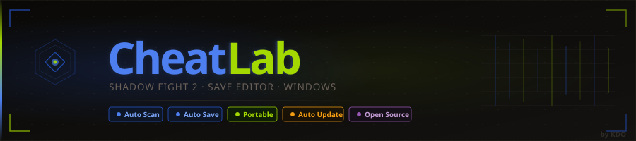

<div align="center">
  
</div>

<div align="center">

  [](https://github.com/kdo2064/cheatlab/releases)
  [](https://github.com/kdo2064/cheatlab/releases)
  [](https://github.com/kdo2064/cheatlab/stargazers)
  [](https://github.com/kdo2064/cheatlab/forks)
  [](LICENSE)
  [](https://github.com/kdo2064/cheatlab)

</div>

---

## What is CheatLab?

**CheatLab Desktop** is an offline save file editor for **Shadow Fight 2** — built for Windows. It reads your SF2 save file, lets you edit every value you want, and writes it back. No root, no cheat engine, no internet. Just open your save, mod it, done.

---

## What You Can Edit

### Dashboard
- **Coins** — set any amount up to 999,999,999
- **Gems** — set any amount up to 999,999,999
- **Level** — set player level (1–52)
- **Energy** — set energy value, or toggle **Unlimited Energy** (removes the energy limit entirely)
- **Inventory summary** — see how many weapons, armors, helms, ranged, and magic items you own

### Weapons / Armor / Helms / Ranged & Magic
- **Own or unown** any item with a single toggle
- **Set upgrade level** — type a number or hit MAX to fully upgrade
- **Equip** any item directly from the editor

### Shadow
- **Strength** — set up to 9,999
- **Stamina** — set up to 99
- **Shadow Body upgrade** — set up to 99,999 (HP + Speed)
- **Shadow Head upgrade** — set up to 99,999 (Critical hits)
- **Shadow Fists upgrade** — set up to 99,999 (Attack Speed)
- **Equipped loadout** — change your active Weapon, Armor, Helm, Ranged and Magic from dropdowns

### Levels & Zones
- **Unlock any battle** across all 6 zones
- **Set current zone** — jump directly to any zone (Sensei → Butcher → Wasp → Hermit → Shogun → Widow)

---

## MAX EVERYTHING

One button on the Dashboard sets everything to maximum in one click:

| What | Value |
|---|---|
| Coins | 999,999,999 |
| Gems | 999,999,999 |
| Level | 52 |
| Strength | 9,999 |
| Stamina | 99 |
| Zone | Zone 6 (Widow) |
| All items | Owned + fully upgraded |
| All battles | Unlocked |
| Shadow Body/Head/Fists | 99,999 |
| Energy | Unlimited |

---

## Other Features

| Feature | Description |
|---|---|
| **Auto Scan** | Finds SF2 saves automatically — Windows Store, BlueStacks, LDPlayer, Nox, MEmu |
| **Auto Save** | Saves changes 1 second after you stop editing |
| **Backup** | Creates a `.backup` of your original save on first save — never lose the original |
| **Restore Backup** | One click to go back to the backed-up save |
| **Auto Update** | Downloads new versions from GitHub silently — no reinstall needed |
| **Portable** | Single `.exe`, no install, no Node.js needed |
| **Offline** | No server, no account, no internet required |

---

## Supported Games

| Game | Status |
|---|---|
| Shadow Fight 2 | ✅ **Supported** — Windows Store · BlueStacks · LDPlayer · Nox · MEmu |
| Minecraft | 🔜 Coming soon |
| Terraria | 🔜 Coming soon |
| Stardew Valley | 🔜 Coming soon |

---

## Download

<div align="center">

[](https://github.com/kdo2064/cheatlab/releases/latest)

</div>

| File | Type | Info |
|---|---|---|
| `CheatLab Setup x.x.x.exe` | Installer | Recommended — desktop shortcut, auto-update |
| `CheatLab-x.x.x-portable.exe` | Portable | No install — copy anywhere and run |

---

## Build from Source

> Requires [Node.js 18+](https://nodejs.org)

```bash
git clone https://github.com/kdo2064/cheatlab.git
cd cheatlab
npm install

# Dev mode (hot reload)
npm run dev

# Build Windows installer + portable
npm run build:win
```

Output → `dist-electron/`

---

## Project Structure

```
cheatlab/
├── electron/
│   ├── main.cjs          # Main process — file I/O, IPC, auto-updater
│   └── preload.cjs       # Context bridge (renderer ↔ main)
├── src/
│   ├── components/
│   │   ├── TitleBar.tsx      # Window chrome, save status, update banner
│   │   ├── Sidebar.tsx       # Game selector
│   │   ├── FileDropZone.tsx  # Home screen — scan + open
│   │   └── sf2/              # SF2 editor tabs
│   │       ├── DashboardTab.tsx
│   │       ├── ItemsTab.tsx
│   │       ├── ShadowTab.tsx
│   │       └── LevelsTab.tsx
│   └── App.tsx
├── public/               # Static assets (logo, wordmark, banner)
├── assets/               # Build assets (app icon for electron-builder)
└── .github/workflows/
    ├── ci.yml            # Push → typecheck + build verify
    └── release.yml       # Tag → build + GitHub Release
```

---

## CI / CD

| Trigger | Action |
|---|---|
| Push to `main` | TypeScript check + Vite build verify |
| Push `v*.*.*` tag | Full Windows build → GitHub Release + upload `.exe` |

```bash
git tag v1.0.1
git push origin v1.0.1
```

---

## Contributing

Bug fixes, new game support, UI improvements — all welcome.

1. Fork this repo
2. `git checkout -b feature/my-feature`
3. Commit and open a Pull Request

### Adding a new game

SF2's implementation is the reference. Follow the same pattern (parser → types → editor tabs) and open a PR.

### Credit

If you fork CheatLab and build something new — go ahead. Just keep the original credit visible:

```
Based on CheatLab by KDO — https://github.com/kdo2064/cheatlab
```

---

## License

[MIT](LICENSE) — free to use, modify, and distribute.

<div align="center">
  <br/>
  
  <br/>
  <sub>Built by <strong>KDO</strong></sub>
</div>
