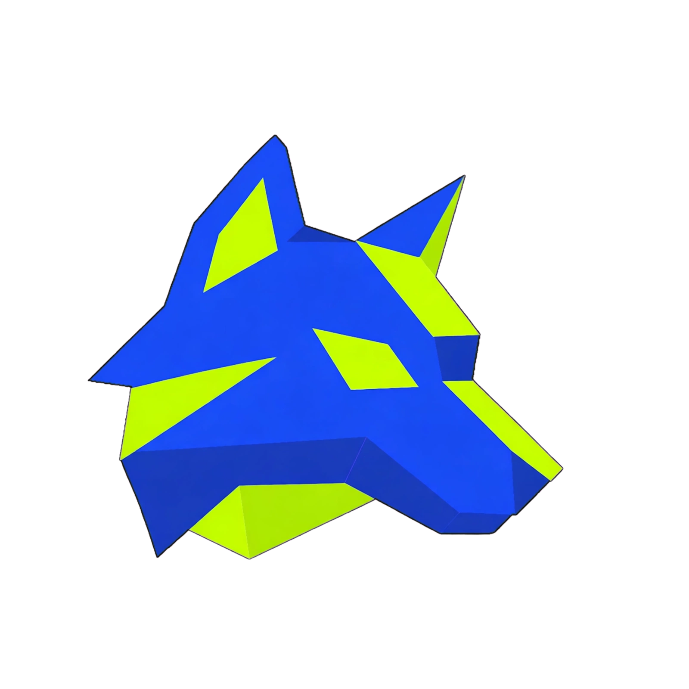
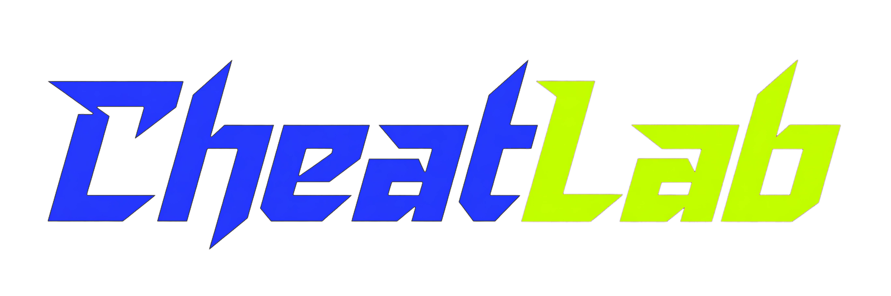

<div align="center">
  <br/>
  <br/>
  <p><strong>Professional Game Save Editor — Desktop</strong></p>

  <p>
    
    
    
    
    
  </p>

  <p>
    
    
    
  </p>
</div>

---

## What is CheatLab?

**CheatLab Desktop** is a fast, offline-capable save file editor for mobile games — built for Windows. No browser, no internet required. Just open your save, edit values, save — done.

Currently supports **Shadow Fight 2** with a clean, tool-like interface built for power users.

---

## Features

- **Auto Scan** — automatically finds SF2 save files from Windows Store, BlueStacks, LDPlayer, Nox, MEmu, and more
- **Auto Save** — 1-second debounce auto-save with manual override
- **BOM Fix** — handles Windows Store saves with UTF-8 BOM (the common "parse error" fix)
- **Auto Update** — pulls new releases from GitHub automatically, no reinstall needed
- **Portable** — single `.exe`, no Node.js or runtime required on target machine
- **Frameless UI** — custom window chrome, drag regions, professional dark theme

---

## Supported Games

| Game | Status |
|---|---|
| Shadow Fight 2 | ✅ Fully supported |
| Minecraft | 🔜 Coming soon |
| Terraria | 🔜 Coming soon |
| Stardew Valley | 🔜 Coming soon |

---

## Download

> Head to [**Releases**](../../releases) for the latest build.

| File | Description |
|---|---|
| `CheatLab Setup x.x.x.exe` | Installer (recommended) |
| `CheatLab-x.x.x-portable.exe` | Portable — no install, run anywhere |

---

## Build from Source

> Requires [Node.js 18+](https://nodejs.org)

```bash
# Clone
git clone https://github.com/kdo2064/cheatlab.git
cd cheatlab

# Install dependencies
npm install

# Run in dev mode
npm run dev

# Build Windows installer + portable
npm run build:win
```

Output goes to `dist-electron/`.

---

## Project Structure

```
cheatlab/
├── electron/           # Main process (Node.js / Electron)
│   ├── main.cjs        # App entry, IPC handlers, file I/O
│   └── preload.cjs     # Context bridge (renderer ↔ main)
├── src/                # Renderer process (React + TypeScript)
│   ├── components/     # UI components
│   └── App.tsx         # Root component
├── public/             # Static assets (logo, wordmark)
├── assets/             # Build assets (app icon)
└── .github/workflows/  # CI/CD — auto build on push, release on tag
```

---

## CI / CD

| Trigger | Action |
|---|---|
| Push to `main` | TypeScript check + Vite build (verify only) |
| Push tag `v*.*.*` | Full Windows build → upload `.exe` to GitHub Release |

To ship a release:

```bash
git tag v1.0.1
git push origin v1.0.1
```

GitHub Actions handles the rest.

---

## Contributing

Contributions are welcome — bug fixes, new game support, UI improvements, anything.

### How to contribute

1. **Fork** this repo
2. Create a branch: `git checkout -b feature/your-feature`
3. Make your changes and commit
4. Open a Pull Request

### Credit

If you fork CheatLab and build on top of it — great. Just keep the original credit in your project:

```
Based on CheatLab by KDO — https://github.com/kdo2064/cheatlab
```

No need to ask permission — just don't remove the attribution. That's the only ask.

---

## Adding a New Game

Game parsers live in `src/` — each game gets its own component/tab. SF2's parser is in the editor components as a reference. PRs adding new game support are especially welcome.

---

## License

[MIT](LICENSE) — free to use, modify, and distribute.  
Built by **KDO**.
